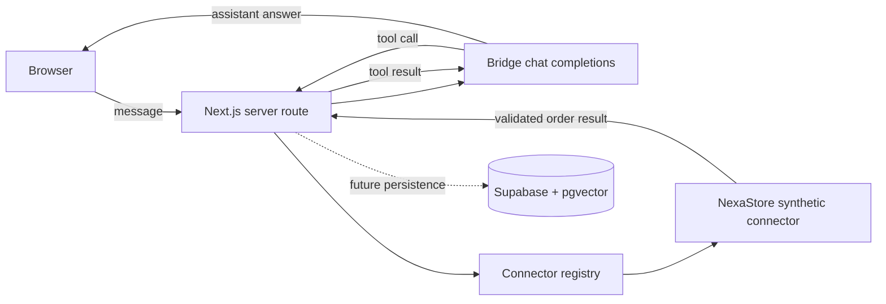

# Dacksoft architecture

Dacksoft separates provider orchestration from business connectors. The initial app has a Next.js App Router UI and a server-side chat route. The route calls Bridge, validates any proposed tool call with Zod, executes only registered connector functions, returns a final assistant message, and includes a redacted execution trace.

## Current implementation

- `src/lib/ai/bridge.ts`: server-only OpenAI SDK client pointed at Bridge.
- `src/lib/ai/tools.ts`: strict argument parsing and allowlisted tool dispatch.
- `src/lib/connectors/`: connector contract and NexaStore demo implementation.
- `src/lib/demo/data.ts`: deterministic synthetic customer/order fixtures.
- `src/app/api/chat/route.ts`: bounded tool loop and redacted per-request trace.
- `supabase/migrations/`: tenant-aware schema and RLS foundation.

The starter UI currently shows a dashboard, sample conversations, demo order lookup prompt, and execution inspector. Conversation, inbox, knowledge, and settings elements are not yet backed by persistent services. There is no authentication flow yet. Do not deploy this starter as a real multi-tenant support service until auth, tenant-scoped APIs, persistence, and rate limiting are implemented.
